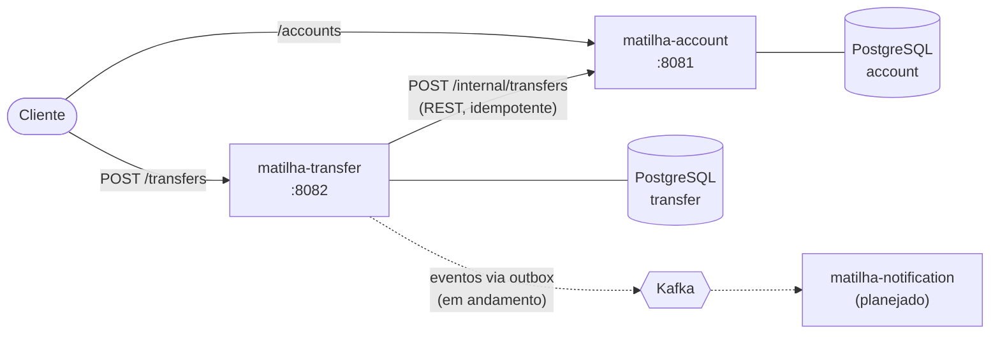

# Matilha

Sistema bancário em microsserviços com Java 25 e Spring Boot 4.1. Abre contas, faz depósitos e transfere dinheiro entre contas, com foco no que costuma dar errado em sistemas distribuídos: requisições repetidas, timeouts, concorrência e falhas parciais.

Cada serviço vive na sua própria pasta deste monorepo, com banco, build, testes, Dockerfile e pipeline independentes.

## Arquitetura



| Serviço | Responsabilidade | Status |
|---|---|---|
| [matilha-account](matilha-account/) | Contas, saldo e movimentações. É o único serviço que altera saldos. | ✅ Pronto |
| [matilha-transfer](matilha-transfer/) | Recebe pedidos de transferência, pede ao account para mover o dinheiro e guarda o resultado | ✅ Fase síncrona pronta, eventos em andamento |
| matilha-gateway | Porta de entrada da API e roteamento | 🚧 Planejado |
| matilha-notification | Consome os eventos de transferência e notifica o cliente | 🚧 Planejado |

## Como rodar

Pré-requisito: Docker.

```bash
cp matilha-account/.env.example matilha-account/.env
cp matilha-transfer/.env.example matilha-transfer/.env
# edite os dois .env e defina usuário e senha dos bancos

docker compose up --build
```

| O quê | Endereço |
|---|---|
| matilha-account (Swagger) | http://localhost:8081/swagger-ui.html |
| matilha-transfer (Swagger) | http://localhost:8082/swagger-ui.html |
| Kafka UI | http://localhost:8090 |

Os serviços sobem no perfil `dev`, que carrega contas de exemplo (`10001` a `10005`). Para testar uma transferência:

```bash
curl -i -X POST http://localhost:8082/transfers \
  -H "Content-Type: application/json" \
  -H "Idempotency-Key: 3f1c2a9e-7b4d-4c1a-9e2f-5a6b7c8d9e01" \
  -d '{"sourceAccountNumber": "10001", "targetAccountNumber": "10002", "amount": 250.50}'
```

Rode o mesmo comando de novo: a resposta é a mesma e o dinheiro só sai da conta uma vez.

Outros modos de rodar, endpoints, regras e testes estão no README de cada serviço. A [collection do Postman](postman/matilha-transfer.postman_collection.json) testa o fluxo inteiro.

## Decisões principais

- **Um banco por serviço.** O transfer nunca toca no banco do account. Ele pede a operação pela API interna, e o account é o único dono do saldo.
- **Idempotência ponta a ponta.** O cliente manda um `Idempotency-Key`. O transfer repassa o id da transferência ao account, que também é idempotente. Um reenvio, seja do cliente ou do próprio sistema, nunca move o dinheiro duas vezes.
- **Timeout não é falha.** Se o account não responde, a transferência fica `PENDING`, não `FAILED`, porque o dinheiro pode ter sido movido e a resposta ter se perdido. Um reconciliador agendado reenvia as pendentes. Ele usa `FOR UPDATE SKIP LOCKED` com uma reserva com prazo, então funciona com várias réplicas.
- **Sem transação aberta durante chamada de rede.** O transfer grava `PENDING`, chama o account fora de transação e grava o resultado numa segunda transação.
- **Concorrência resolvida no banco.** O account trava as contas com `SELECT ... FOR UPDATE`, sempre na mesma ordem, o que evita deadlock. O saldo não negativo é garantido na entidade e numa constraint.
- **Schema só pelo Flyway.** O Hibernate roda com `ddl-auto: validate`, e os testes sobem um PostgreSQL real com Testcontainers, então testam o mesmo schema de produção.
- **Erros no formato Problem Details (RFC 9457)**, com o detalhe interno só no log.

## Stack

Java 25, Spring Boot 4.1 (Web MVC, Data JPA, Validation, Actuator), PostgreSQL 17, Flyway, Kafka, RestClient, springdoc-openapi, JUnit 5, Mockito, MockMvc, Testcontainers, Docker Compose e GitHub Actions (um workflow por serviço: testes e build da imagem).

## Roadmap

- [x] matilha-account: contas, depósitos e transferências com lock e idempotência
- [x] matilha-transfer: orquestração síncrona com idempotência e reconciliador de pendentes
- [ ] Eventos de transferência no Kafka com transactional outbox (tabela criada, publicação em andamento)
- [ ] matilha-notification consumindo os eventos
- [ ] matilha-gateway como porta de entrada
- [ ] Autenticação com Keycloak
- [ ] Deploy no Kubernetes
