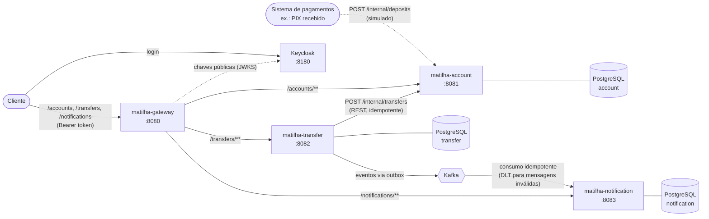

# Matilha

Sistema bancário em microsserviços com Java 25 e Spring Boot 4.1. Abre contas, faz depósitos e transfere dinheiro entre contas, com foco no que costuma dar errado em sistemas distribuídos: requisições repetidas, timeouts, concorrência e falhas parciais.

Cada serviço vive na sua própria pasta deste monorepo, com banco, build, testes, Dockerfile e pipeline independentes.

## Arquitetura



O cliente faz login no Keycloak e fala só com o gateway, mandando o token JWT em toda requisição. O gateway conhece três rotas, e qualquer outro caminho, inclusive `/internal/**`, recebe `404`. O gateway e cada um dos três serviços validam o token sozinhos, pela chave pública do Keycloak, e cada usuário vê e movimenta só as próprias contas. O transfer chama o account por dentro, e o depósito chega direto no account, como faria um sistema de pagamentos na rede interna.

| Serviço | Responsabilidade | Status |
|---|---|---|
| [keycloak](keycloak/) | Login e emissão dos tokens JWT, com o realm versionado no repositório | ✅ Pronto |
| [matilha-gateway](matilha-gateway/) | Porta de entrada da API: roteia as três rotas públicas e bloqueia o resto | ✅ Pronto |
| [matilha-account](matilha-account/) | Contas, saldo e movimentações. É o único serviço que altera saldos. | ✅ Pronto |
| [matilha-transfer](matilha-transfer/) | Recebe pedidos de transferência, pede ao account para mover o dinheiro, guarda o resultado e publica o evento | ✅ Pronto |
| [matilha-notification](matilha-notification/) | Consome os eventos de transferência, registra a notificação de cada conta envolvida e permite consultá-las | ✅ Pronto |

## Como rodar

Pré-requisito: Docker.

```bash
cp matilha-account/.env.example matilha-account/.env
cp matilha-transfer/.env.example matilha-transfer/.env
cp matilha-notification/.env.example matilha-notification/.env
cp keycloak/.env.example keycloak/.env
# edite os quatro .env: usuário e senha dos bancos e o admin do console do Keycloak

docker compose up --build
```

**A porta oficial é a 8080, do gateway.** As portas 8081, 8082 e 8083 continuam publicadas em `127.0.0.1` para depuração e para o Swagger de cada serviço, mas não são a entrada da API. No Kubernetes, só o gateway e o Keycloak ficam expostos.

| O quê | Endereço |
|---|---|
| **matilha-gateway (API)** | **http://localhost:8080** |
| Keycloak (login e console) | http://localhost:8180 |
| matilha-account (Swagger) | http://localhost:8081/swagger-ui.html |
| matilha-transfer (Swagger) | http://localhost:8082/swagger-ui.html |
| matilha-notification (Swagger) | http://localhost:8083/swagger-ui.html |
| Kafka UI | http://localhost:8090 |

Os serviços sobem no perfil `dev`, que carrega contas de exemplo (`10001` a `10005`). A `10001` é da Ana e a `10002` é do Bruno, dois usuários de demonstração do Keycloak (as senhas estão no [keycloak/README.md](keycloak/README.md)). As outras contas não têm dono e só o admin enxerga.

Toda chamada pelo gateway precisa de um token. Pegue o da Ana (com `jq`; no PowerShell, veja o [keycloak/README.md](keycloak/README.md#pegar-um-token-pelo-terminal)):

```bash
TOKEN=$(curl -s http://localhost:8180/realms/matilha/protocol/openid-connect/token \
  -d grant_type=password -d client_id=matilha-dev-cli -d username=ana -d password=ana123 | jq -r .access_token)
```

O token vale 5 minutos. Para testar uma transferência:

```bash
curl -i -X POST http://localhost:8080/transfers \
  -H "Authorization: Bearer $TOKEN" \
  -H "Content-Type: application/json" \
  -H "Idempotency-Key: 3f1c2a9e-7b4d-4c1a-9e2f-5a6b7c8d9e01" \
  -d '{"sourceAccountNumber": "10001", "targetAccountNumber": "10002", "amount": 250.50}'
```

Rode o mesmo comando de novo: a resposta é a mesma e o dinheiro só sai da conta uma vez.

Em seguida, veja as notificações da Ana, geradas pelo evento da transferência. O `TRANSFER_RECEIVED` da 10002 aparece só para o Bruno:

```bash
curl -H "Authorization: Bearer $TOKEN" "http://localhost:8080/notifications"   # TRANSFER_SENT
```

A conta de outra pessoa se comporta como se não existisse, e sem token nada passa:

```bash
curl -i -H "Authorization: Bearer $TOKEN" http://localhost:8080/accounts/10002   # 404, code ACCOUNT_NOT_FOUND
curl -i http://localhost:8080/accounts/10001                                      # 401, code UNAUTHENTICATED
```

E veja o gateway bloqueando um endpoint interno, sem que a requisição chegue ao account:

```bash
curl -i -X POST -H "Authorization: Bearer $TOKEN" http://localhost:8080/internal/deposits   # 404, code ROUTE_NOT_FOUND
```

O `compose.yaml` da raiz inclui a infraestrutura (`infra/compose.yaml`: Kafka e Kafka UI), o Keycloak (`keycloak/compose.yaml`) e o compose de cada serviço. Para subir só uma parte, rode na raiz com o nome dos serviços, por exemplo `docker compose up -d transfer-db kafka`.

Outros modos de rodar, endpoints, regras e testes estão no README de cada serviço. Há duas collections do Postman em [postman/](postman/), as duas pegando o token no Keycloak sozinhas:

- [matilha.postman_collection.json](postman/matilha.postman_collection.json): o roteiro com testes, para o Collection Runner. Cobre o fluxo inteiro pelo gateway, a segurança (`401`, `403` e as `404` da regra de dono, com a Ana e o Bruno) e, numa pasta manual, o login pelo navegador com Authorization Code + PKCE.
- [matilha-endpoints.postman_collection.json](postman/matilha-endpoints.postman_collection.json): uma requisição por endpoint, sem testes, para explorar a API.

## Como rodar no Kubernetes

O mesmo sistema roda num cluster local com [kind](https://kind.sigs.k8s.io/), com **duas réplicas de cada serviço**, o gateway em `http://localhost:8080` e o Keycloak em `http://localhost:8180`, os dois únicos expostos. Os endereços são os mesmos do compose, então os comandos acima e as collections funcionam igual. Pré-requisitos: Docker Desktop, kind e kubectl.

```powershell
# copie os k8s/infra/*-secret.example.yaml (três bancos e o admin do Keycloak) para *-secret.yaml e defina usuário e senha
.\k8s\deploy.ps1
```

Com duas réplicas, o que os ADRs prometem foi testado com vários processos, e cada prova tem um script em [k8s/provas/](k8s/provas/). Os scripts pegam o token do dono de cada conta no Keycloak, então as provas rodam com a segurança ligada:

- 40 transferências simultâneas em sentidos opostos, com dois accounts disputando as mesmas contas: nenhum deadlock e a soma dos saldos intacta
- account fora do ar: a transferência fica `PENDING`, e uma réplica só do transfer a completa quando ele volta
- `rollout restart` do account com transferências chegando: 253 concluídas, 1 `PENDING` resolvida pelo reconciliador e nenhum erro para o cliente
- as duas réplicas do notification dividindo as partições do Kafka

Como pausar, atualizar um serviço, acessar o que não é público e resolver problemas comuns: [k8s/README.md](k8s/README.md).

## Decisões principais

- **Login no Keycloak, regra de dono nos serviços.** O Matilha nunca vê uma senha: o Keycloak faz o login e emite um JWT assinado. O gateway e os três serviços validam o token sozinhos, pela chave pública, sem chamar o Keycloak a cada requisição. Validar de novo em cada serviço impede que um pod de dentro do cluster pule o gateway. A identidade vem sempre do `sub` do token, nunca do corpo da requisição. A conta guarda o dono, e a conta de outra pessoa se comporta como se não existisse: `404` na leitura e `ACCOUNT_NOT_FOUND` na transferência a partir dela. A transferência grava quem pediu, para o reconciliador reenviar sem token, e o evento leva quem pediu e o dono do destino, para cada notificação ir para a pessoa certa. Detalhes no [ADR-0014](docs/adr/0014-keycloak-e-dono-da-conta.md).
- **Gateway com lista de liberação.** O matilha-gateway (Spring Cloud Gateway Server Web MVC, o mesmo modelo servlet dos outros serviços) conhece só `/accounts`, `/transfers` e `/notifications`. Não existe regra que bloqueia `/internal/**`: o bloqueio é a ausência de rota. Assim, um endpoint interno novo, com qualquer prefixo, nasce protegido. Serviço fora do ar vira `503` em Problem Details, e o health do gateway não depende dos serviços, para a queda de um não derrubar as rotas dos outros. Detalhes no [ADR-0012](docs/adr/0012-gateway-webmvc-e-rotas-liberadas.md).
- **Um banco por serviço.** O transfer nunca toca no banco do account. Ele pede a operação pela API interna, e o account é o único dono do saldo.
- **Idempotência ponta a ponta.** O cliente manda um `Idempotency-Key`. O transfer repassa o id da transferência ao account, que também é idempotente. Um reenvio, seja do cliente ou do próprio sistema, nunca move o dinheiro duas vezes.
- **Depósito é entrada externa.** O `/internal/deposits` representa dinheiro vindo de fora, como um PIX recebido, e é chamado pelo sistema de pagamentos com o ID da operação dele. Como o Matilha não tem esse sistema, ele é simulado por chamada direta. Não é uma operação administrativa e não passa pelo gateway.
- **Dados pessoais ficam no account.** Os eventos de transferência levam só números de conta, valor, código do resultado e os ids opacos dos usuários no Keycloak, nunca nome, e-mail ou telefone. Por isso o matilha-notification não manda e-mail: ele registra no banco e no log que a notificação foi gerada para a conta. Enviar e-mail de verdade exigiria que ele consultasse o account de forma síncrona ou que o evento carregasse dados pessoais, e os dois anulam o motivo de usar eventos. O que ele demonstra é o consumo idempotente: uma mensagem repetida não gera uma segunda notificação.
- **Timeout não é falha.** Se o account não responde, a transferência fica `PENDING`, não `FAILED`, porque o dinheiro pode ter sido movido e a resposta ter se perdido. Um reconciliador agendado reenvia as pendentes. Ele usa `FOR UPDATE SKIP LOCKED` com uma reserva com prazo, então funciona com várias réplicas.
- **Sem transação aberta durante chamada de rede.** O transfer grava `PENDING`, chama o account fora de transação e grava o resultado numa segunda transação.
- **Eventos pelo transactional outbox.** O evento é gravado na tabela `outbox_events` na mesma transação que muda o status da transferência, então não existe transferência terminada sem evento, nem evento de algo que não foi gravado. Um publicador agendado envia ao Kafka e só marca como publicado depois da confirmação do broker. Ele usa o mesmo `SKIP LOCKED` com reserva do reconciliador. A entrega é "pelo menos uma vez", e o consumidor descarta duplicatas pelo `eventId`.
- **Consumidor idempotente com Dead Letter Topic.** O notification grava o `eventId` em `processed_events` na mesma transação que as notificações, e só confirma o offset no Kafka depois do commit. Um evento repetido é ignorado. Uma mensagem que nunca vai funcionar (JSON inválido, versão ou tipo desconhecido) vai direto para a DLT. Uma falha de infraestrutura, como o banco fora do ar, é repetida sem limite com espera crescente, para não mandar mensagens boas para a DLT.
- **Concorrência resolvida no banco.** O account trava as contas com `SELECT ... FOR UPDATE`, sempre na mesma ordem, o que evita deadlock. O saldo não negativo é garantido na entidade e numa constraint.
- **Schema só pelo Flyway.** O Hibernate roda com `ddl-auto: validate`, e os testes sobem um PostgreSQL real com Testcontainers, então testam o mesmo schema de produção.
- **Erros no formato Problem Details (RFC 9457), com um `code` como contrato.** O account devolve códigos como `INSUFFICIENT_BALANCE`. O transfer converte esses códigos para um enum próprio, grava na transferência e repassa no evento. Nenhum serviço depende do texto em inglês do `detail`, e o detalhe interno de um erro inesperado fica só no log.

## Stack

Java 25, Spring Boot 4.1 (Web MVC, Data JPA, Validation, Actuator), Spring Security (OAuth2 Resource Server com JWT), Keycloak 26, Spring Cloud Gateway Server Web MVC (2025.1, Oakwood), PostgreSQL 17, Flyway, Kafka (Spring Kafka), RestClient, springdoc-openapi, JUnit 5, Mockito, MockMvc, Testcontainers, Awaitility, Docker Compose, Kubernetes (kind e Kustomize) e GitHub Actions (um workflow por serviço: testes e build da imagem).

## Roadmap

- [x] matilha-account: contas, depósitos e transferências com lock e idempotência
- [x] matilha-transfer: orquestração síncrona com idempotência e reconciliador de pendentes
- [x] Códigos de erro no Problem Details, propagados do account até o evento
- [x] Eventos de transferência no Kafka com transactional outbox
- [x] matilha-notification consumindo os eventos (registro idempotente, sem envio real)
- [x] matilha-gateway como porta de entrada, com rotas por lista de liberação
- [x] Deploy no Kubernetes, com só o gateway exposto e duas réplicas de cada serviço
- [x] Login com Keycloak, token validado no gateway e em cada serviço, e regra de dono da conta de ponta a ponta
- [ ] Segurança entre serviços: client credentials no `/internal/**`, SASL/SCRAM com ACLs no Kafka e NetworkPolicy
